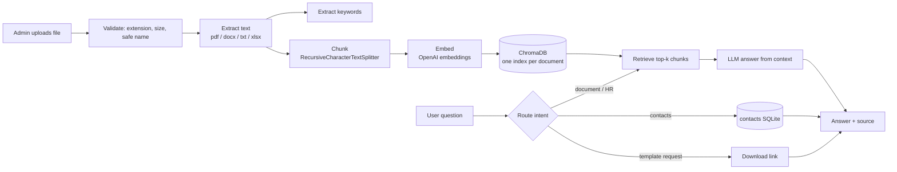

# RAG Chatbot (Azerbaijani)

A document-aware chatbot for Azerbaijani-language HR/office questions. Admins upload documents
(PDF, DOCX, TXT, Excel, ...); the backend extracts text, chunks and embeds it into ChromaDB, and an
OpenAI model answers questions using the retrieved passages. A small phone-book search and a
template-download flow ("send me the leave application form") round out the assistant.

> The repository ships **synthetic demo data only** (fictional people and policies).

## Features

- Upload, download, reprocess and delete documents (admin only), with keyword extraction
- Retrieval-augmented answers with source attribution, stored as per-user conversations
- Intent routing: HR policy questions, template downloads, contact lookup, general questions
- Contact search by name / department / sector backed by SQLite
- JWT bearer tokens and cookie sessions, role-based access (`user` / `admin`)
- React + Vite + Tailwind frontend

## Tech stack

Flask 3, SQLite, ChromaDB, LangChain text splitters / vector-store wrapper, OpenAI API, React 18, Vite,
Tailwind, Docker (gunicorn + nginx), pytest, ruff, ESLint, GitHub Actions.

## Architecture



More detail in [docs/architecture.md](docs/architecture.md).

## Screenshots

Placeholders - see the capture checklist in [docs/images/README.md](docs/images/README.md).

## Quick start (Docker)

```bash
cp .env.example .env     # set OPENAI_API_KEY, SECRET_KEY, JWT_SECRET_KEY (and ADMIN_PASSWORD)
docker compose up --build
docker compose exec backend python scripts/seed_demo_data.py   # demo contacts + sample docs
```

Open http://localhost:3000. If you left `ADMIN_PASSWORD` empty, the generated admin password is printed once in
`docker compose logs backend`. Then, as admin, call `POST /api/templates/initialize` (or upload the files in
`example_docs/` from the UI) to load the demo documents.

## Quick start (without Docker)

```bash
# backend (Python 3.11+)
cd backend
python -m venv .venv && source .venv/bin/activate      # Windows: .venv\Scripts\activate
pip install -r requirements.txt
cp ../.env.example .env                                  # edit it
python scripts/seed_demo_data.py
python wsgi.py                                           # http://localhost:5000

# frontend (Node 20+), in a second terminal
cd frontend
npm ci
npm run dev                                              # http://localhost:3000 (proxies /api to :5000)
```

## Configuration

| Variable | Default | Purpose |
|----------|---------|---------|
| `OPENAI_API_KEY` | - | OpenAI key (required) |
| `LLM_MODEL` | `gpt-4o-mini` | Chat model |
| `EMBEDDING_MODEL` | `text-embedding-3-small` | `text-embedding-*` uses OpenAI; anything else uses HuggingFace (needs `sentence-transformers`) |
| `SECRET_KEY` / `JWT_SECRET_KEY` | random per process in dev | **Required** when `FLASK_ENV=production` |
| `ADMIN_USERNAME` / `ADMIN_PASSWORD` | `admin` / random, printed once | Admin created on first start if none exists |
| `FLASK_ENV` | `development` | `production` enforces secrets and secure cookies |
| `DEBUG` | `false` | Flask debug and verbose logs |
| `CORS_ORIGINS` | `http://localhost:3000,http://127.0.0.1:3000` | Comma-separated allowed origins |
| `COOKIE_SECURE` / `COOKIE_SAMESITE` | secure in production / `Lax` | Session cookie flags |
| `DATABASE_FILE` | `rag_chatbot.db` | App SQLite DB |
| `CONTACTS_DB_FILE` | `contacts.db` | Phone-book SQLite DB |
| `VECTOR_DB_PATH` | `chroma_db` | Chroma persistence dir |
| `UPLOAD_FOLDER` | `documents` | Uploaded files |
| `MAX_FILE_SIZE` | 10 MB | Upload limit (bytes) |
| `CHUNK_SIZE` / `CHUNK_OVERLAP` / `SEARCH_RESULTS_COUNT` | 1000 / 200 / 5 | RAG tuning |

## API reference

All routes are under `/api`. "auth" = JWT bearer token (from login/register) or session cookie.

| Method and path | Access | Description |
|-----------------|--------|-------------|
| `GET /health` | public | Status and model names |
| `GET /` (i.e. `/api`) | public | API index |
| `POST /auth/register` | public | Create user (`username` >= 3 chars, `password` >= 6) |
| `POST /auth/login` | public | Returns `access_token` and user |
| `POST /auth/logout` | public | Clears session |
| `GET /auth/check` | public | Is the caller authenticated |
| `GET /auth/me` | auth | Current user |
| `POST /chat/ask` | auth | `{question, document_id?, conversation_id?}` |
| `GET /chat/conversations` | auth | List own conversations |
| `GET`/`DELETE /chat/conversations/<id>` | auth | Fetch / delete one |
| `PUT /chat/conversations/<id>/rename` | auth | `{title}` |
| `GET /documents` | auth | List documents |
| `GET /documents/types` | public | Document type list |
| `GET /documents/templates`, `GET /templates` | auth | Template documents |
| `GET /documents/<id>/download` | auth | Download file |
| `GET /documents/<id>/keywords` | auth | Keywords |
| `POST /documents/search-by-keywords` | auth | `{keywords: []}` |
| `POST /documents` | admin | Multipart upload (`file`, `document_type`, `is_template`) |
| `POST /documents/upload-with-keywords` | admin | Upload with manual `keywords` |
| `DELETE /documents/<id>` | admin | Delete document and vectors |
| `POST /documents/<id>/reprocess` | admin | Re-extract, re-chunk, re-embed |
| `PUT /documents/<id>/keywords`, `POST .../add-keywords`, `DELETE .../remove-keyword` | admin | Edit keywords |
| `POST /admin/documents/bulk-reprocess` | admin | Reprocess many |
| `POST /templates/initialize` | admin | Load documents from `example_docs/` |

## Testing

```bash
cd backend && pip install -r requirements-dev.txt && ruff check . && pytest
cd frontend && npm run lint && npm run build
```

Backend tests use a fake LLM client and fake embeddings, so they need no network or API key.

## Design decisions and limitations

- **SQLite + one Chroma index per document**: zero-ops and easy to reason about; limits you to one worker.
- **Keyword-based intent routing** instead of an LLM router: deterministic and cheap, but tuned to Azerbaijani phrasing.
- **JWT + session**: JWT for the SPA/serverless, filesystem sessions as a fallback.
- Not production-hardened: no rate limiting or password reset. See [docs/limitations.md](docs/limitations.md).
- Security measures that *are* implemented: hashed passwords, env-driven secrets that must be set in production,
  role checks on mutating routes, upload extension/size validation with sanitised filenames, no debug endpoints.
- Vercel files live in `deploy/vercel/` (experimental; SQLite/Chroma are not persistent there).

## Roadmap

- Move to `langchain-chroma`, streaming answers, per-user document ACLs
- Rate limiting, password reset, audit log
- i18n for UI strings, evaluation set for retrieval quality

## License

MIT - see [LICENSE](LICENSE).
